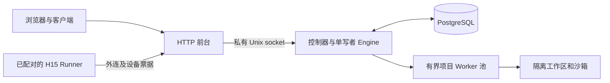

# H16 多用户项目与服务端调度

## 开启项目隔离

升级到 `0057_harness_tenants.sql` 后，已有管理员、浏览器会话、项目对话和迁移哈希可以继续使用。实例仍由一个管理员启动，管理员以原浏览器登录或本机操作者令牌管理项目。项目加入受管理范围后，使用自己的凭据、授权和服务端队列。

| 管理操作 | 入口 |
| --- | --- |
| 创建或列出成员账户 | `POST /api/v3/agent/accounts` 接收 `username` 和 `password`，`GET` 列出账户。 |
| 登记工作区 | 通过原 `POST /api/v3/harness/projects` 登记操作者选择的目录。 |
| 启用项目隔离 | `PUT /api/v3/agent/projects/{id}/quota` 接收 `max_parallel` 和 `max_queued`，将配额绑定到工作区注册指纹。 |
| 保存项目凭据 | `PUT /api/v3/agent/projects/{id}/credentials` 接收 `deepseek_api_key`、可选 `github_read_token`、`model_id`、`context_policy`。响应包含凭据版本。 |
| 授予生产执行预算 | `POST /api/v3/agent/projects/{id}/authorization` 复用现有工作区权限、累计金额和模型次数。 |
| 分配和撤销成员 | `PUT /api/v3/agent/projects/{id}/members/{user_id}` 分配 `reader` 或 `contributor`。对相同地址执行 `DELETE` 撤销。 |

受管理项目使用独立的登记目录。目录与其他项目或 Harness 服务数据重叠时，项目配置和当前访问会被拒绝。

先在本机使用管理员身份登记项目，再设置该项目的配额、凭据和累计预算，最后分配成员。成员登录同一页面后进入项目助手，选择已分配项目并输入需求。`reader` 可以发起只读调查。`contributor` 在项目允许时也可修改隔离工作树，执行固定验证命令并下载补丁。宿主目录注册、改回源目录、预览、发布、Runner 设备配对和全局设置由管理员处理。

每个成员授权生成自己的绑定。同一项目中的不同成员各自持有会话和任务，幂等请求标识也在绑定内使用。撤销后会话、任务、事件流和日志的访问立即失效。再次授权建立新绑定，原会话继续保留在管理员可复核的记录中。成员可以从自己任务的 `/artifacts` 响应取得命令日志地址。每个地址同时验证任务归属及日志在该任务中的回执。全局 CAS 入口仅提供给管理员。

受管理项目凭据加密保存，模型请求绑定凭据版本。清空模型 Key 可关闭该项目的模型调用。轮换凭据或撤销成员会阻止尚未派发的旧请求，并释放对应的未使用预占。已经派发的请求仍按供应商回执记账。项目预算按成员共享同一个原费用账本，各项目额度独立。

## 调度和恢复



控制器在 PostgreSQL 事务里检查项目和全局剩余排队槽，存入任务及原树的指纹。Worker 从持久任务队列领取，依次复核项目并发数、全局并发数和执行版本。某项目的运行槽用尽时，其他有空闲额度的项目仍可推进。`MGAR_V3_HARNESS_QUEUE_LIMIT` 控制所有受管理项目待处理任务数，`MGAR_V3_MAX_CONCURRENT_RUNS` 控制受管理 Worker 池。队列容量包含等待派发与持久暂停的项目任务，运行中等待用户输入的任务占用当前运行槽。旧单管理员项目、既有业务图和 H15 设备测试保持各自的执行入口。

控制器重启时从 PostgreSQL 恢复队列，接续从未执行的任务。运行中断的任务按 H11 持久暂停，用户可以请求有界恢复。已经保存的模型结果从原 Run 复用，未知效果保留待核实状态。第二个控制器与第一个控制器竞争同一个 Engine 锁，只有获锁进程可以执行业务事务。

## 分离进程启动

升级时先备份数据库和凭据密钥，停止旧控制器，再应用 `0057` 并启动 H16 控制器。启用成员后，控制器须使用实现成员授权的 H16 源码。回退旧运行时应恢复升级前数据库备份，使账户数据与访问规则对应。

本机仍可用原来的单进程启动方式。需要分离 HTTP 前台时，在已准备 PostgreSQL、锁定依赖与隔离镜像的 `v3/` 目录启动以下两个进程。

```bash
# 控制器终端
make migrate
install -d -m 0700 "$PWD/.local/h16-controller"
umask 077
uv run --frozen uvicorn mgar_v3.api:create_app --factory \
  --uds "$PWD/.local/h16-controller/api.sock" --forwarded-allow-ips '*'
```

```bash
# HTTP 前台终端
export MGAR_H16_CONTROLLER_SOCKET="$PWD/.local/h16-controller/api.sock"
uv run --frozen uvicorn mgar_v3.harness.gateway:create_app --factory \
  --host 127.0.0.1 --port 18080 --no-proxy-headers
```

前台只需 socket 地址。控制器凭据与数据库配置留在控制器进程。前台保留来自受信入口的请求协议，并转发 Cookie、CSRF 校验和 SSE；每个浏览器的 Cookie 独立使用。控制器 socket 放在操作者私有目录。对外提供服务时按实际 HTTPS 域名设置 `MGAR_V3_WEB_ALLOWED_HOSTS` 和 `MGAR_V3_WEB_ALLOWED_ORIGINS`，并在受信的 HTTPS 入口终止 TLS。由前置代理终止 TLS 时，只让 HTTP 前台接收该代理的转发协议头。H15 Runner 按原设备流程接入此入口。[Runner 使用说明](RUNNER.md)

实例部署使用一个有权写入的控制器。控制器停止期间，前台返回服务暂不可用。测试报告记录排队时延、隔离、续跑和正向迁移的本机实测结果。[H16 任务卡](TASKS.md#hv4-h16)
